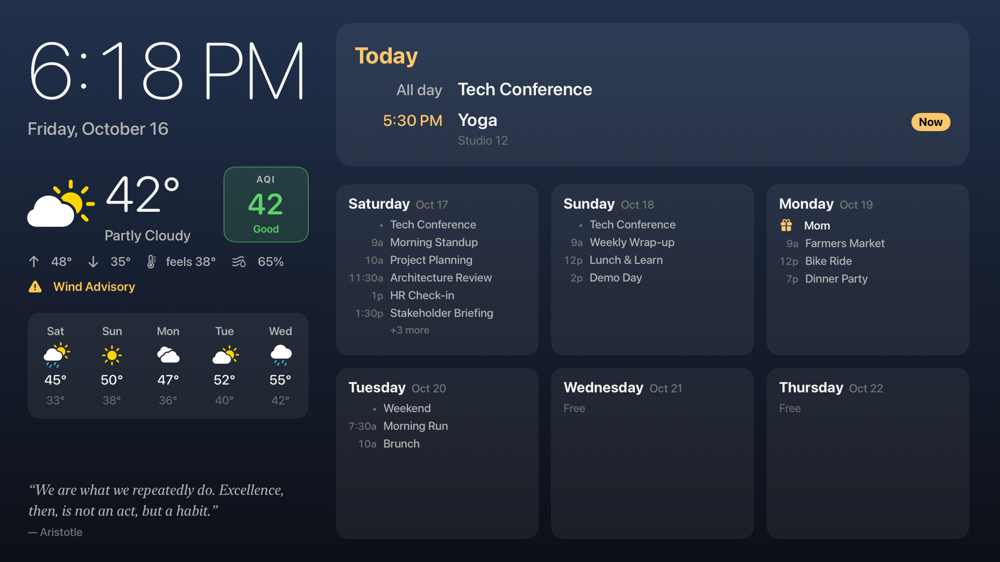
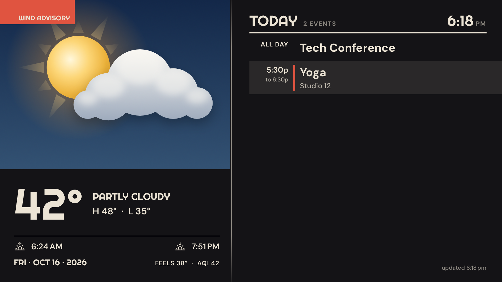
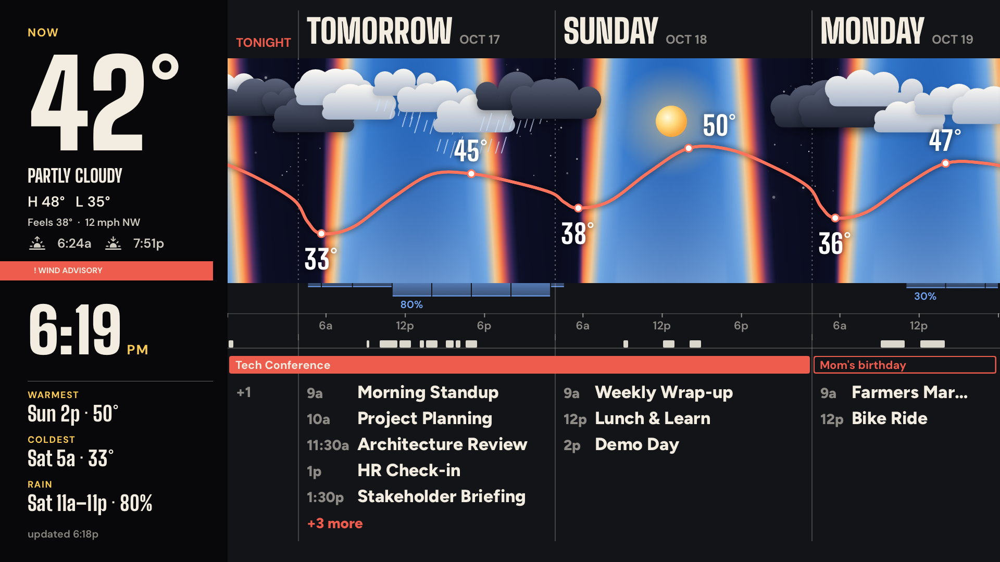
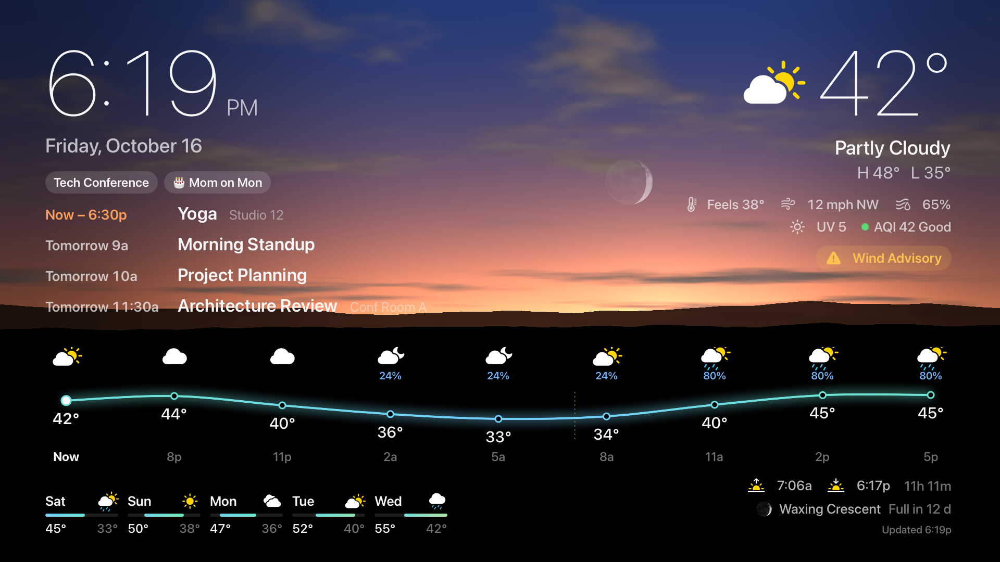
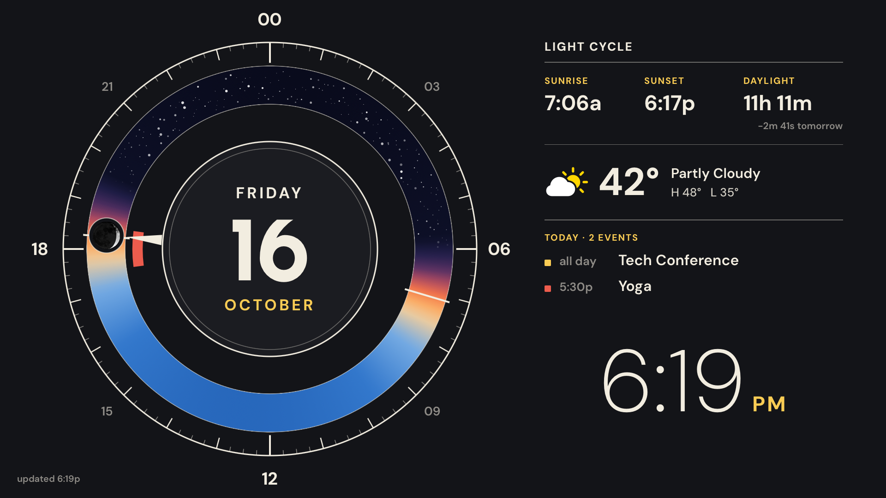
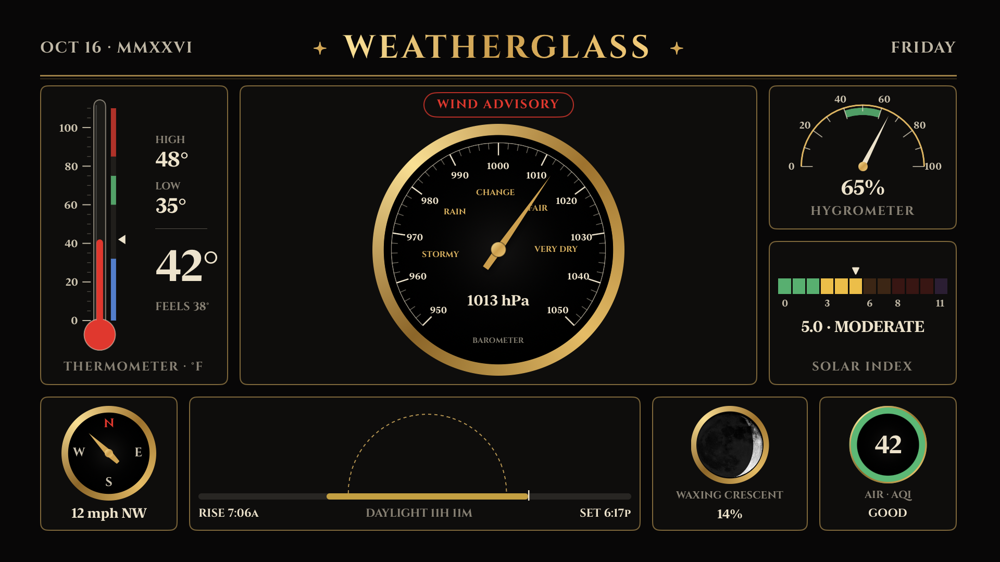
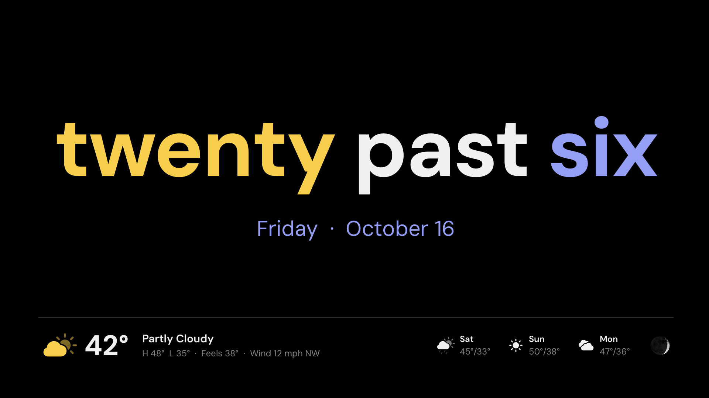
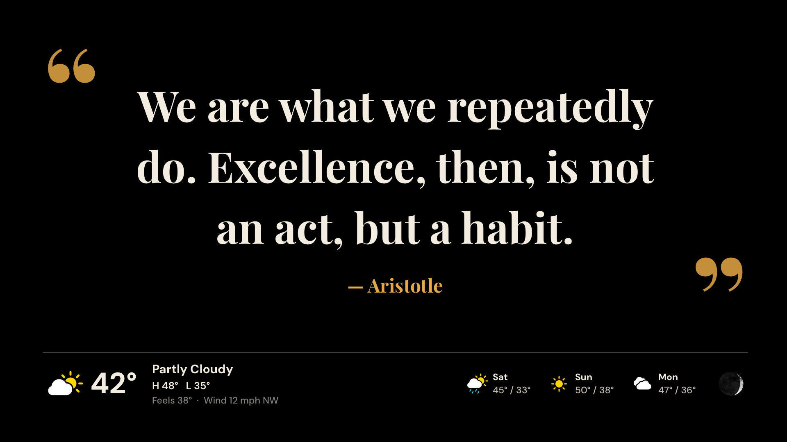
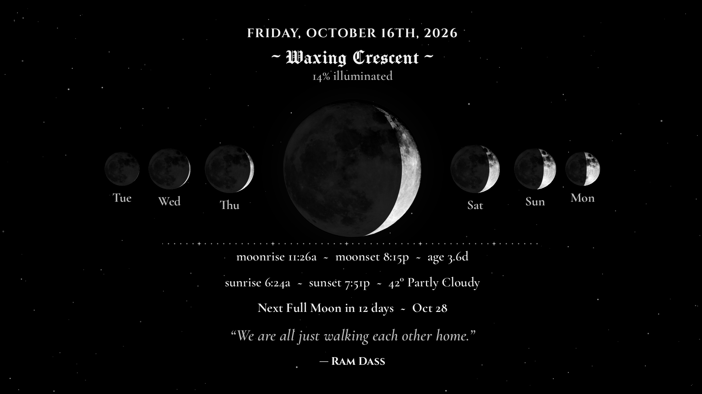
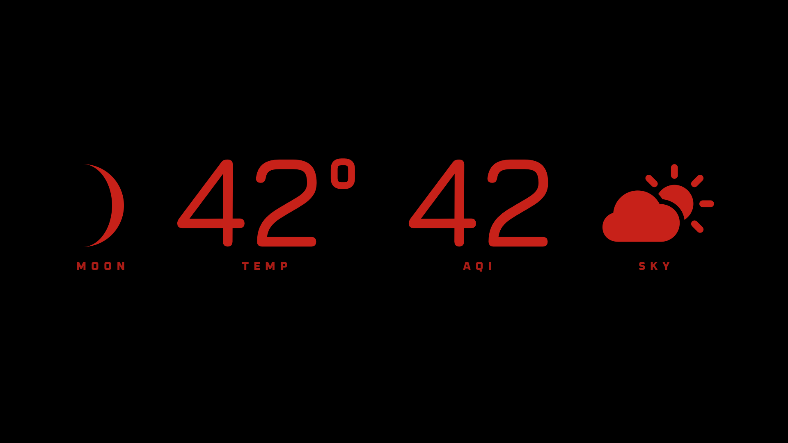

# Home Dashboard for Apple TV

[](https://github.com/gkoch02/HomeDashboardTV/actions/workflows/ci.yml)
[](https://github.com/gkoch02/HomeDashboardTV/actions/workflows/github-code-scanning/codeql)
[](#building-it-yourself)
[](https://github.com/gkoch02/HomeDashboard)
[](LICENSE)

The tvOS companion to [HomeDashboard](https://github.com/gkoch02/HomeDashboard), the Raspberry Pi e-ink dashboard.
The Pi keeps doing the fetching (Google Calendar / ICS / CalDAV, OpenWeatherMap, birthdays)
on its own timer; this app reads the Pi's cached snapshot from `GET /api/dashboard` and
draws it natively at TV resolution, with no e-ink pixels and no credentials on the TV.

It is not on the App Store: it needs your own HomeDashboard Pi, and you build it onto your
Apple TV yourself with Xcode ([Building it yourself](#building-it-yourself)).



**Agenda**, after the Pi's `halftone_agenda`: a painted weather window on the left, the
day's agenda on the right, in cream on charcoal with ochre and red.



**Horizon**, the Pi's `wide_horizon`: the next 72 hours on one time axis, with the sky
coloured by the sun's altitude, the forecast temperature line and the calendar beneath.



**Skylight**, drawn for an OLED TV: a live Metal sky with the current weather and the sun or
moon above, the day's events over it, and the next 24 hours on a true-black ground.



**Light Cycle**, the Pi's `light_cycle`: today as a 24-hour dial with the day's events as arcs,
beside the sun times, the weather and the agenda.



**Weatherglass**, the Pi's `weatherglass`: Victorian instruments for temperature, pressure
(with its trend), humidity, UV, wind, sun, moon and air quality.



**Fuzzy Clock**, the Pi's `fuzzyclock`: the time in words to the nearest five minutes, over
the date and a weather strip.



**Quote**, the Pi's `qotd`: the quote of the day, over a weather strip.



**Moon**, the Pi's `moonphase_photo`: today's moon from the photograph, three days either
side, rise and set times, the weather and the quote.



**Night**, the Pi's `wide_night_invert`: the moon's phase, temperature, air quality and sky
in dim red on black.



Pick a layout in settings → Layout.

## What the TV needs

- The Pi's web UI running, with HomeDashboard 6.2 or later (the `/api/dashboard` route):
  `make web-enable` on the Pi. That also advertises it over Bonjour as `_homedash._tcp`
  when `avahi-daemon` is installed (it is on Raspberry Pi OS), so the TV finds it by itself.
- The web UI's username and password, if one is set (`python -m src.web.auth --set-password`).
  The password is kept in the TV's Keychain.

On first launch the app opens its settings drawer at **Source**: pick the Pi under **On This
Network**, or type its address (`dashboard.local`, `192.168.1.20:8080`). **Demo data** shows a
bundled week with no Pi at all. Click anywhere on the dashboard to open the drawer again;
Menu goes back a page, then closes it.
Left and right on the remote step through the layouts (Dashboard, Agenda, Horizon, Skylight,
Light Cycle, Weatherglass, Fuzzy Clock, Quote, Moon, Night), and
the one you land on is remembered.

## Building it yourself

You need a Mac with Xcode, an Apple TV on the same network as the Pi, and an Apple
developer account. A paid Apple Developer Program membership is the dependable route: its
development profiles last a year. A free Apple ID (a personal team) may also work, but what
it installs stops launching after 7 days until you build it again.

1. Pair the Apple TV with Xcode: on the TV, **Settings → Remotes and Devices → Remote App
   and Devices**; on the Mac, **Window → Devices and Simulators** in Xcode, then pick the TV
   and enter the code it shows.
2. Give the build your own signing. The team and bundle prefix in the project are the
   author's; yours go in a local file that git ignores:

   ```bash
   cp Config/Signing.local.xcconfig.example Config/Signing.local.xcconfig
   ```

   Set `DEVELOPMENT_TEAM` to your team ID (Xcode → Settings → Accounts) and
   `BUNDLE_ID_PREFIX` to a reverse-DNS prefix of your own.
3. Open `HomeDashboardTV.xcodeproj`, choose your Apple TV as the run destination and run
   the **HomeDashboard** scheme. Xcode makes the profile (automatic signing) and installs
   the app.

On first launch, allow local network access so the app can find the Pi, then pick it in
settings. The committed project is complete, so XcodeGen is only needed to change
`project.yml` (see [Building](#building)).

## How it behaves

- Polls every 5 minutes (every minute after a failure). Polling costs the Pi no API quota:
  the route reads the cache and never fetches.
- Keeps the last good snapshot on screen when the Pi is unreachable and says since when.
  A source the Pi reports as stale is named in the corner; an expired one is not drawn.
- Days and times are in the Pi's configured zone, so the TV agrees with the panel.
- Air quality (when the Pi has PurpleAir on) sits beside the temperature as a badge in its EPA
  band's colour, so a bad-air day reads from across the room.
- A busy week never overflows: the day cards always keep their room, and Today and each card
  pick the richest layout that fits (wrapped titles, then single lines, then a count of the
  rest). A title too long even for two lines ends in "…".
- The layout drifts a few points every ten minutes, so an OLED TV never holds one image.
- The screensaver and sleep are held off while the app is open, always or for 1–8 hours after
  the last remote press (settings → Keep awake); after that the Apple TV's own timers apply.

## Layout

- `Packages/DashboardCore`: the payload model, decoding of the Pi's Python timestamps, the
  agenda (events per day in the Pi's zone), the HTTP client and the demo-data shift. No UI;
  `swift test` runs it on the Mac.
- `HomeDashboardTV/App`: the polling store, Bonjour discovery and the Keychain.
- `HomeDashboardTV/UI`: the three layouts, each a `Theme` (`Theme.swift`), and the settings
  panel. `UI/Parts` holds what layouts share: the painted weather window (`WeatherArt`, its
  composition `WeatherScene` in `DashboardCore`; `docs/agenda-scenes.png` shows six of them),
  the moon disc, a starfield.
- `HomeDashboardTV/Resources/Fonts`: Cinzel, Cormorant Garamond, Manufacturing Consent,
  Righteous, DM Sans, Big Shoulders Display and Figtree from HomeDashboard's `fonts/` (SIL OFL; each licence beside its font). The moon
  photograph (`MoonPhoto`) is the author's own full moon: the full-resolution original of
  the Pi's `assets/moon_full.png`, cropped to the disc at its native 1288 px with the
  disc's levels stretched, enough for the hero moon at 4K without upscaling.
- `HomeDashboardTV/Resources/demo-snapshot.json` and the test fixture are real output of the
  Pi's route over HomeDashboard's dummy data.

## Adding a layout

A layout is a view conforming to `Theme`: its body is the plate, `backdrop` what sits still
behind it, and optionally `notice(_:)` its style for the corner line. `ThemeFrame` adds the
burn-in drift, the notice's place and the Pi's time zone, so a layout only draws. Set
`fullBleed` to have the whole screen instead of the overscan safe area, and keep a 10 pt margin
for the drift. Then add a case to `DashboardStore.Layout` and a line to
`DashboardScreen.content`; the settings list picks it up. Keep its inks and faces `private` to
its file, and list any new font under `UIAppFonts` in `project.yml`.

## Icon

`scripts/generate_brand_assets.py` renders the layered app icon and the Top Shelf images into
the asset catalog (Pillow). The icon is a calendar page over an amber sun on the app's sky,
showing one week as the app does, today's column in amber; the parallax tilt slides the page across the sun. Previews are
in `docs/app-icon.png` and `docs/top-shelf.png`.

```bash
python3 scripts/generate_brand_assets.py
```

## Building

The project is generated by XcodeGen and committed, as in the other PlumpBug apps. After
editing `project.yml`, run `xcodegen` and commit the result; `Tools/check_project_sync.sh`
fails when the two disagree.

```bash
xcodegen
```

```bash
cd Packages/DashboardCore && swift test
```

In the simulator, `-server <address>` or `-demo YES` sets the source for one run, and
`-layout dashboard|agenda|moon|horizon` the layout:

```bash
xcrun simctl launch booted dev.plumpbug.homedashboard -server 127.0.0.1:8080
```

(With your own `BUNDLE_ID_PREFIX`, the bundle identifier is `<prefix>.homedashboard`.)

A device build needs a registered Apple TV for its development profile; signing is set up
as in [Building it yourself](#building-it-yourself).

## License

MIT — see [LICENSE](LICENSE). The bundled typefaces are third-party works under the SIL
Open Font License 1.1, each shipped with its upstream license text, and the demo data
carries a few short quotations that are not ours to license; the **Third-party content**
section of [LICENSE](LICENSE) sets out both.
